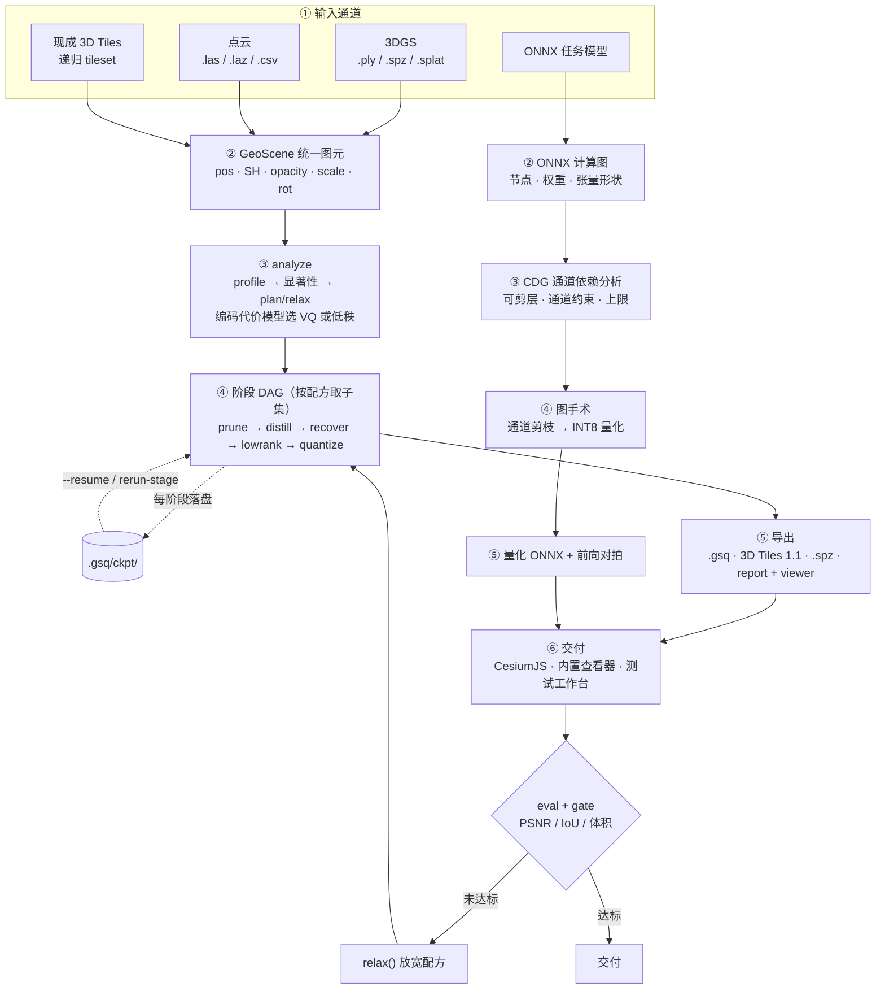

# GeoSqueeze 架构（当前实现）

本文记录**代码里实际跑通的调用关系**，与 `geosqueeze_design.md`（最初设计稿）的差异见文末对照表。

## 主链路

一条地理数据主链路 + 一条模型旁路，二者只共享"先分析、再按配方压"的思路，数据表示不互通。

要点：

- **阶段是 DAG 的子集**，不是固定五步。`prune` 有 4 种实现（`significance` / `render` / `merge` / `voxel`），`quantize` 有 3 种（`affine` / `VQ` / `RVQ`），配方里出现哪些就执行哪些。
- **checkpoint 横切整条链路**：每阶段落盘 `.gsq/ckpt/`，与输入场景指纹绑定，支撑 `compress --resume` 续跑和 `rerun-stage` 单阶段重跑。
- **门禁回流是唯一回边**，且每轮必须从原始场景重跑（不是在上轮产物上继续剪），最多 3 轮。
- **模型线不经过 GeoScene**，产物是 `.onnx`，靠 onnxruntime 前向对拍（余弦相似度 + 时延）验收。

## 模块分层

`gsq` 包共 22 个模块 7,831 行：

| 分组 | 模块 | 职责 |
|---|---|---|
| 核心流水线 | `ir` `analyze` `stages` `pipeline` `export` | 中间表示、画像与配方、阶段算子、编排与 checkpoint、导出与评测 |
| 摄取适配 | `tiles_in` `vector` `mesh` `raster` `samples` | 已有 3D Tiles / 矢量 / 网格 / 栅格读入，合成样例 |
| 交付与验证 | `viewer` `cesium_viewer` `vec_viewer` `mesh_viewer` `testbench` | 自包含 WebGL 查看器、Cesium 查看器、数据源测试工作台 |
| 旁路与入口 | `model` `spz` `cli` `render` | ONNX 压缩、SPZ 编解码、命令行、渲染辅助 |

## 数据契约

| 项 | 约定 |
|---|---|
| `GeoScene.opacity` | 已过 sigmoid，直接是可乘的不透明度 |
| `GeoScene.scale` | 线性尺度（未取 log） |
| `GeoScene.rot` | 四元数，`wxyz` 顺序 |
| `GeoScene.sh` | `(n, k, 3)`，`k=(deg+1)^2`；点云只有 `k=1` |
| 坐标轴 | 自产 tileset 为 Z-up 直存（`asset.gltfUpAxis: "Z"`）；外部数据按规范做 Y-up→Z-up |
| `.gsq` payload | 整型 codec + 反量化参数，不是 f32 转储 |

## 与最初设计稿的差异

| 设计稿 | 当前实现 | 说明 |
|---|---|---|
| 单条 3DGS/点云管线 | 主链路 + 模型线双轨 | 矢量 / 网格 / 栅格另有独立路径，**未汇入主图** |
| 打包写 SOG / SPZ | SPZ 已实现（v2 写出、v2/v3 读取） | SOG 未做 |
| 阶段顺序固定 | 由编码代价模型决策，可跳过 / 可重跑 | `plan()` 内 VQ 与低秩按代价二选一 |
| 无断点 | 阶段级 checkpoint + `--resume` / `rerun-stage` | 设计 §5 落地 |
| recipe.json | `--recipe` 支持 JSON 与 YAML（含设计方言） | 设计 §4.2 落地 |

## 已知边界

- `EXT_meshopt_compression` / Draco 压缩的 glb 只能在线渲染，不能进入 `compress-tiles`（无原生解码）；
  3DBAG LoD2.2 属此类。
- 蒸馏只对带球谐的 3DGS 有意义；现成 3D Tiles 网格/点云瓦片只能剪枝 + 量化。
- SPZ v4（ZSTD 多流）读取直接报错；SH>3 阶丢弃（规范上限）。
- 模型线不支持分组卷积与控制流子图；`Reshape` / `Add` / `Concat` 等通道约束节点保守跳过并计入 `skipped`。
- 未实现：SOG、QAT（需 torch）、LPIPS（需 torch）、e57 读取。

## 尚未收拢的地方

矢量、网格、栅格三条线（`vector.py` / `mesh.py` / `raster.py`）各有自己的简化 + 整型化 + 拓扑去重实现，
**没有复用 `stages` 的阶段 DAG**。若要"一套架构统一所有数据形态"，这是当前最大的不一致点。
